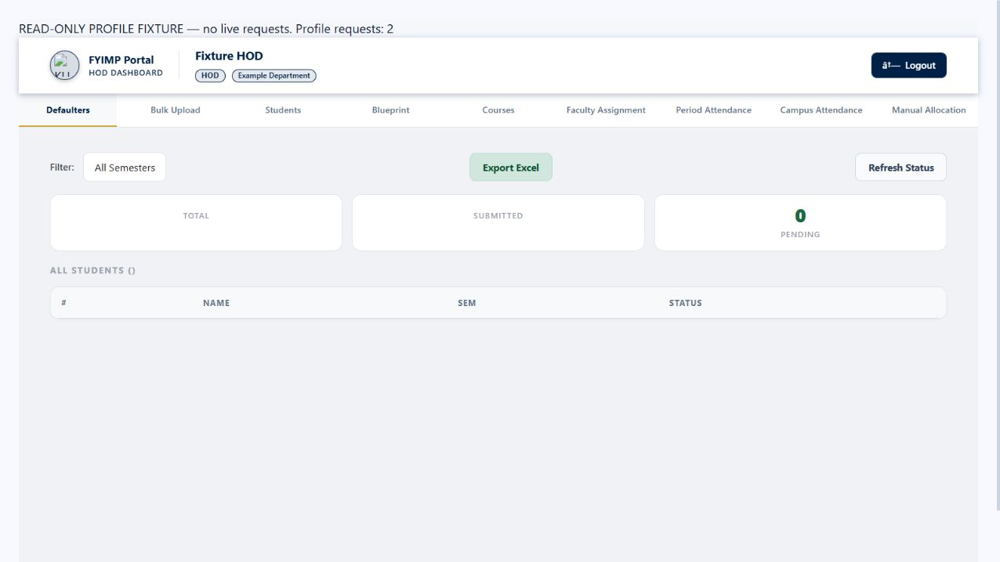

# HOD profile loading fix — 19 October 2026

## Cause and change

The faculty table has both `faculty_department_id_fkey` and the newer composite
`faculty_department_campus_fk`. An implicit `departments(name)` embed therefore
fails with PostgREST `PGRST201` (ambiguous relationships). This breaks the separate
profile request even while the other HOD dashboard requests succeed.

Faculty profile, superadmin faculty list and teacher schedule queries now select
the department relationship explicitly with `!faculty_department_id_fkey`. The
response shape remains unchanged. Foreign keys, permissions and account data are
unchanged; this release needs no migration or data correction.

The HOD retry clears the previous warning immediately. Aborted profile requests
cannot update the profile or redirect the page after a newer request takes over.

## Verification

- Read-only live database probe: legacy faculty embed returned `PGRST201`;
  explicit embed resolved both department and campus successfully.
- Actual updated AuthService loaded an existing HOD profile successfully through
  read-only queries. No Auth sessions or production records were created/changed.
- Nine new regression tests cover all four faculty roles, null department,
  student compatibility, faculty listing, teacher schedule and HOD login preload.
- Combined serial regression run: **50 passed, 0 failed**, including staff
  restrictions, department metadata, password errors, middleware and logout.
- Backend build and frontend production build/type checks passed.
- `git diff --check` passed.
- Isolated browser preview using the actual HOD component: first profile request
  failed while the dashboard remained usable; clicking Try again cleared the
  warning, displayed loading, then rendered the HOD name and department on request
  two. The fixture blocks mutations and makes no live requests.

## Release checks

Frontend deployment status and backend readiness/restart are checked after push.
The authenticated live HTTP profile endpoint is not tested by impersonating a
user; the read-only actual-service probe above verifies the production database
relationship and response. Users can refresh their dashboard or click Try again
after backend rollout.
