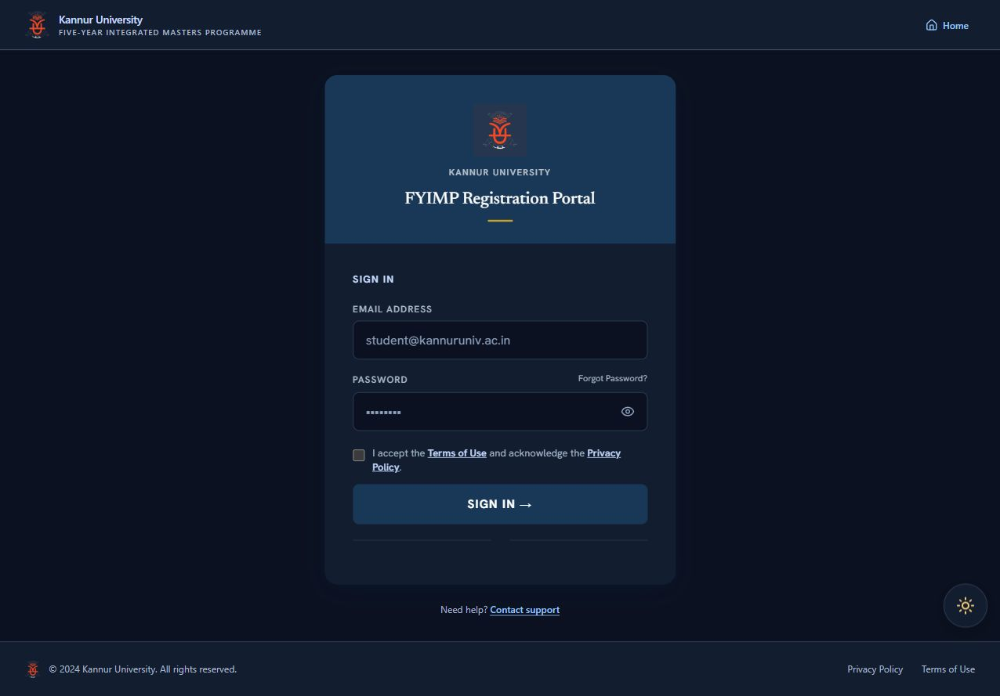

# University logo loading — 19 October 2026

## Findings

The source PNG exists and is valid (59,742 bytes). On the fresh live login page,
all three optimized image variants loaded successfully during inspection; an
image-optimization outage was not reproduced.

A separate live GET with `Cookie: session_ended=1` reproduced a real asset-routing
bug: `/knrunilogo.png` returned **307 /login, text/plain**. The logout fence treated
the public image as a protected page. It must not send login content for an image.

## Changes

- All 13 logo call sites now use `UniversityLogo`, retaining their dimensions,
  styles, alternative text and loading priority.
- The component statically imports the existing PNG, producing one versioned
  `/_next/static/media/...png` asset. It serves the image directly without requiring
  per-size image optimization; subsequent uses share the browser cache.
- The legacy public logo URL explicitly bypasses the session fence, supporting
  existing pages during rollout. Protected page/session behaviour is unchanged.
- No database, account, authentication policy or original logo artwork changed.

## Verification

- Frontend production build and TypeScript checks passed.
- Session/logout regressions: **17 passed, 0 failed**, including the new public
  image test with no cookie, a logout marker, and a marker plus stale credentials.
- Built-app HTTP checks with a logout marker: both legacy and bundled logo URLs
  returned **200 image/png**, 59,742 bytes, without redirects.
- Browser inspection of the actual production build: header, login-card and
  footer images all reported `complete=true`, `naturalWidth=278` and the same
  versioned static source. No credentials were entered.
- All six dashboard roles, student loading/registration, director timetable and
  password-change logo imports compile using that same shared component. These
  protected screens were not exercised by creating or impersonating accounts.
- `git diff --check` passed.

